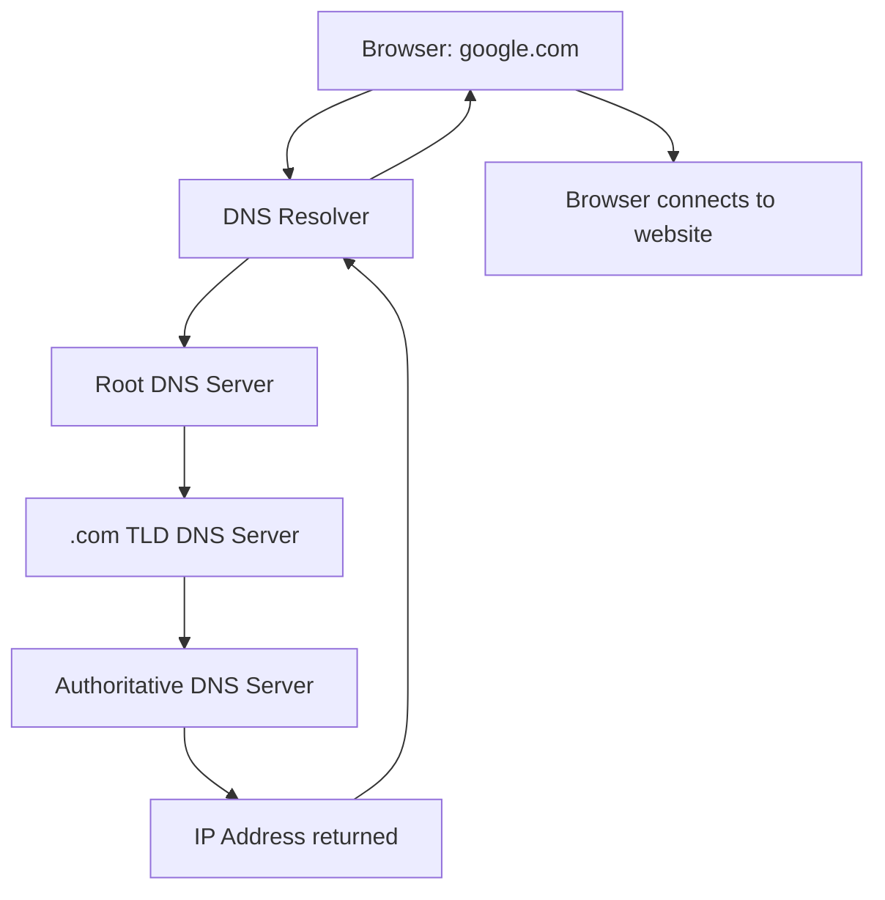

DNS (Domain Name System) translates domain names, such as `google.com`, into IP addresses that computers use to communicate.

Think of DNS as the phone book of the internet. You remember a person's name, and the phone book helps you find their phone number. Similarly, you type a website name, and DNS helps your computer find its IP address.

## 1. Why do we need DNS?

Computers communicate using IP addresses, for example:

- Domain name: `google.com`
    
- Example IP address: `142.250.185.14`
    

It's easier for humans to remember names than IP addresses. DNS connects those names to the addresses computers need.

## 2. How does DNS work?

Imagine you want to open `google.com`.

1. Your computer

You enter google.com

2. DNS resolver

Looks for the IP address, using its cache or querying DNS servers

3. DNS response

Returns the IP address for the domain

4. Your browser connects

Uses the IP address to reach the website

Your browser can now connect to the server. DNS finds the address; it does not normally deliver the website content itself.

## 3. What happens behind the scenes?

If the resolver doesn't already have the answer cached, it may query several DNS servers:

In simple terms:

1. The root server points the resolver toward the appropriate top-level domain servers.
    
2. The TLD server for `.com` points it toward the domain's authoritative DNS server.
    
3. The authoritative server provides the requested DNS record.
    
4. The resolver returns the answer to your computer.
    

This is a simplified flow; caching can allow DNS to skip most of these steps.

## 4. Common DNS record types

DNS stores different kinds of records, not just IP addresses.

|Record|Purpose|Example|
|---|---|---|
|`A`|Maps a domain to an IPv4 address|`example.com → 192.0.2.10`|
|`AAAA`|Maps a domain to an IPv6 address|`example.com → IPv6 address`|
|`CNAME`|Points one name to another domain name|`www.example.com → example.com`|
|`MX`|Specifies mail servers|Email delivery|
|`TXT`|Stores text information|Domain verification, SPF|
|`NS`|Identifies authoritative name servers|Domain DNS management|

## 5. What is a DNS server?

A DNS server helps resolve domain names. You might use a public DNS resolver, such as:

- Google Public DNS — `8.8.8.8`
    
- Cloudflare DNS — `1.1.1.1`
    

Your computer usually gets its DNS resolver settings from your router or network configuration.

## 6. DNS vs. IP vs. VLAN

Since you're learning networking concepts, here's how they differ:

|Concept|What it does|
|---|---|
|DNS|Finds the IP address associated with a domain name.|
|IP address|Identifies a network interface for communication.|
|VLAN|Separates a physical network into logical Layer 2 networks.|
|Router|Routes IP traffic between different networks.|
|DHCP|Automatically assigns IP addresses and other network settings to devices.|

Remember: DNS answers "What IP address belongs to this domain name?" It doesn't decide which VLAN a device belongs to or automatically assign its IP address.

---
[[Backend]]