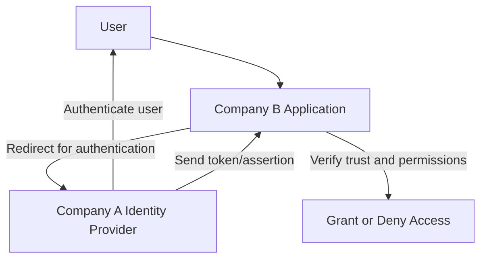

**Federation Architecture** is an architecture in which multiple independent systems, organizations, or services trust each other and communicate without needing to share their internal authentication systems or databases.

In authentication, federation allows users from one organization to access applications or services belonging to another organization using their existing identity.

In simple words:

**You can use your identity from one system to access another system because the two systems trust each other.**

## **1. Example**

Imagine:

- Company A has its own authentication system.
    
- Company B has its own applications.
    
- An employee from Company A needs to access an application owned by Company B.
    

Instead of Company B creating a new username and password for that employee, it trusts Company A's Identity Provider (IdP).

The employee authenticates through Company A and can access Company B's application.

## **2. How does Federation work?**

There are usually three main components:

- **User:** The person trying to access an application.
    
- **Identity Provider (IdP):** The system that authenticates the user.
    
- **Service Provider (SP):** The application that the user wants to access.
    

### **Authentication flow**

1. The user opens an application belonging to Company B.
    
2. Company B's application redirects the user to Company A's IdP.
    
3. Company A's IdP authenticates the user.
    
4. The IdP sends an authentication assertion or token to Company B.
    
5. Company B verifies that the token comes from a trusted IdP.
    
6. The user gets access to the application, according to its authorization rules.
    

## **3. Federation Architecture Diagram**

## **4. Important Concepts**

|Term|Meaning|
|---|---|
|Federation|Trust relationship between independent identity systems|
|IdP|Identity Provider; authenticates users|
|SP|Service Provider; provides the application|
|Trust Relationship|Agreement that one system trusts another system's authentication|
|Identity Federation|Sharing trusted identity information between organizations|
|Federation Protocol|Standard used to exchange authentication information|

## **5. Technologies Used in Federation**

Some common protocols are:

- **SAML 2.0:** Commonly used for enterprise identity federation.
    
- **OIDC:** Used for authentication and identity federation between applications.
    
- **WS-Federation:** An older protocol used in some enterprise environments.
    

## **6. SSO vs. Federation**

These concepts are related but not identical.

|SSO|Federation|
|---|---|
|Allows one login to access multiple applications.|Allows independent identity systems to trust each other.|
|Often used within one organization.|Often used across different organizations.|
|Focuses on the login experience.|Focuses on establishing trust between systems.|

**Example:**

- SSO: You log in once to access your company's email and dashboard.
    
- Federation: You use your company's identity to access an application owned by another company.
    

**Key takeaway:** Federation establishes trust between independent identity systems. SSO uses authentication to provide a seamless login experience across multiple applications. Federation can be used to implement SSO across organizations.

---
[[Backend]]