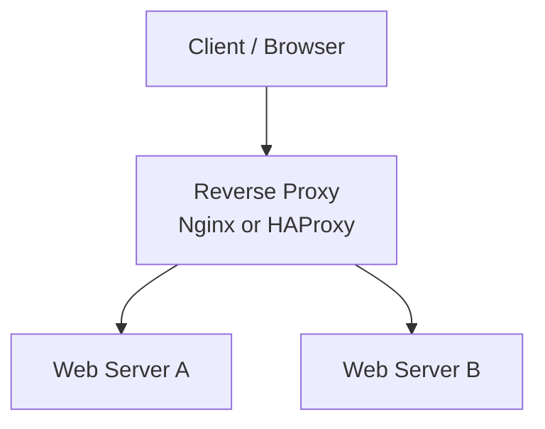
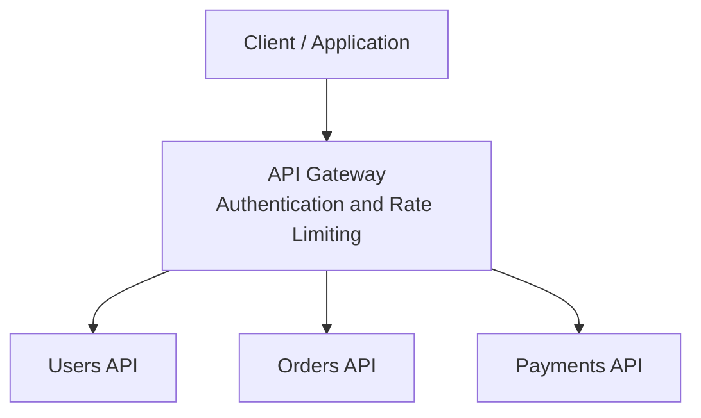
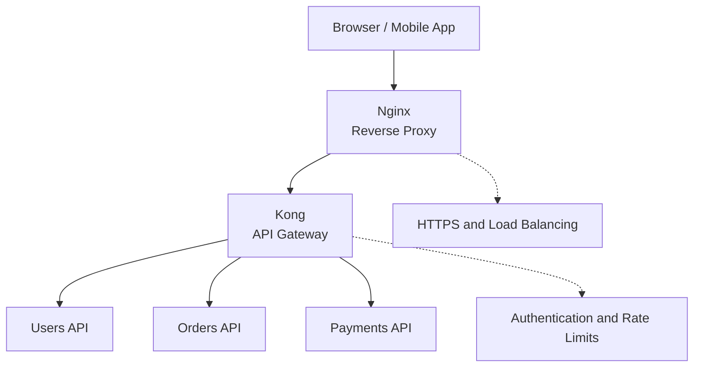

# Gateway vs. Reverse Proxy

A **gateway** describes a broader role of connecting systems and controlling traffic. A **reverse proxy** receives requests on behalf of backend servers and forwards them to the appropriate destination.

They overlap: an API gateway often uses reverse-proxy functionality.

## 1. Simple Analogy

Imagine a company building:

- **Reverse proxy:** A receptionist directs visitors to the right department.
- **API gateway:** A receptionist who also checks IDs, enforces access rules, and manages visitor permissions.

This is an analogy, not a strict technical distinction. Reverse proxies can also perform security checks.

## 2. Reverse Proxy

A reverse proxy sits in front of backend servers and forwards incoming requests.

**Typical responsibilities:**
- Request routing
- Load balancing
- TLS termination (handling HTTPS encryption)
- Caching

## 3. API Gateway

An API gateway manages API requests and applies API-specific policies.

**Typical responsibilities:**
- API key management
- Authentication and authorization
- Rate limiting and quotas
- Request validation
- Analytics and monitoring
- API routing

## 4. Key Differences

| Feature | Reverse Proxy | API Gateway |
|---|---|---|
| Main purpose | Forward traffic to backend servers | Manage and control API access |
| Load balancing | Common | Possible |
| TLS termination | Common | Possible |
| Authentication | Possible | Common |
| Rate limiting | Possible | Common |
| API keys and usage tracking | Not its primary focus | Common |
| Request/response transformation | Possible | Common |
| Typical scope | Web traffic and server routing | APIs and API consumers |

These are typical use cases, not strict rules. A reverse proxy can offer gateway-like features, and an API gateway commonly includes reverse-proxy functionality.

## 5. Can You Use Both Together?

Yes. For example, Nginx can handle incoming traffic while Kong manages API-specific policies.

In this example:

- **Nginx:** Handles incoming traffic, HTTPS, and load balancing.
- **Kong:** Applies API-specific policies and routes requests.
- **Backend APIs:** Execute the application's business logic.

This is one possible architecture. Nginx and Kong have overlapping capabilities, so you don't always need both.

## 6. Which Should You Use?

- **One backend application:** A reverse proxy such as Nginx is often enough.
- **Multiple APIs with centralized authentication, API keys, and quotas:** Consider an API gateway.
- **Multiple backend servers needing traffic distribution:** A reverse proxy or load balancer may be enough.
- **Multiple AI providers:** An AI gateway can centralize model selection, provider credentials, usage tracking, and fallback logic.

## Key Takeaway

A **reverse proxy** forwards requests on behalf of backend servers. A **gateway** provides an entry point between systems and may add broader control and policy features.

An **API gateway** is commonly implemented using reverse-proxy mechanisms, which is why the two concepts overlap.

---
[[Backend]]
[[API-GW]]