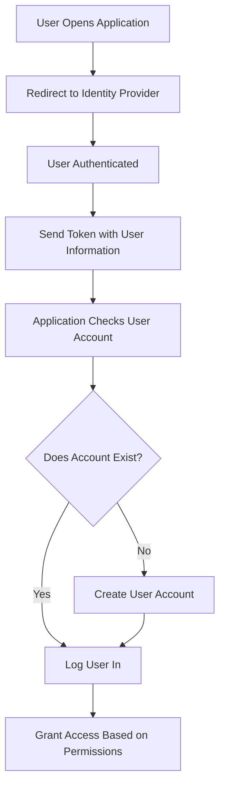

# **What is Just-in-Time (JIT) Provisioning?**

**Just-in-Time (JIT) Provisioning** is a user account creation method in which an application automatically creates a user's account **the first time they successfully log in**.

Instead of creating user accounts in advance, the application creates them when they are needed.

## **1. Why do we need JIT Provisioning?**

Imagine a company uses:

- Keycloak as its Identity Provider (IdP).
    
- Jira as its project management application.
    

A new employee needs access to Jira.

Without JIT Provisioning:

1. An administrator must create the employee's account in Jira.
    
2. The employee logs in using SSO.
    

With JIT Provisioning:

1. The employee opens Jira.
    
2. Jira redirects them to Keycloak for authentication.
    
3. Keycloak authenticates the employee.
    
4. Keycloak sends an authentication token containing user information.
    
5. Jira checks whether the user already has an account.
    
6. If the account doesn't exist, Jira automatically creates one.
    
7. The employee gets access to Jira.
    

## **2. How does JIT Provisioning work?**

## **3. What information can be created?**

When the application receives the user's identity information, it can use it to create an account.

For example:

|Attribute|Example|
|---|---|
|Username|reyhaneh|
|Email|user@company.com|
|First Name|Reyhaneh|
|Last Name|Khosravi|
|Department|Engineering|
|Groups|Developers|

The application can also assign default roles or permissions, depending on its configuration.

## **4. JIT Provisioning vs. SCIM**

Both are used for user provisioning, but they work differently.

|JIT Provisioning|SCIM|
|---|---|
|Creates an account when the user first logs in.|Synchronizes accounts between systems.|
|Triggered by a login attempt.|Triggered by identity changes or provisioning events.|
|Usually creates accounts on demand.|Can create accounts before the user logs in.|
|Usually happens during SSO authentication.|Works independently of the login process.|

### **Example**

Imagine a new employee joins your company.

**With SCIM:**

1. The employee is created in Keycloak.
    
2. Keycloak sends a SCIM request to Jira.
    
3. Jira creates the employee's account.
    
4. The employee can log in later.
    

**With JIT Provisioning:**

1. The employee is created in Keycloak.
    
2. No account is created in Jira yet.
    
3. The employee tries to log in to Jira using SSO.
    
4. Jira automatically creates the account during the login process.
    

## **5. JIT Provisioning and Keycloak**

Keycloak can participate in JIT Provisioning workflows.

For example:

- Keycloak can authenticate users.
    
- Keycloak can send user information through OIDC or SAML.
    
- An application can use that information to create a local user account automatically.
    

JIT provisioning behavior depends on the application receiving the authentication response.

## **6. Quick comparison**

|Concept|Main responsibility|
|---|---|
|SSO|Allows one login across multiple applications.|
|Federation|Establishes trust between independent identity systems.|
|SCIM|Synchronizes user accounts between systems.|
|JIT Provisioning|Creates a user account when they first log in.|
|Keycloak|Centralizes identity and access management.|

**Key takeaway:** JIT Provisioning means _create the account when the user first needs it_, rather than creating it beforehand.

---
[[Backend]]