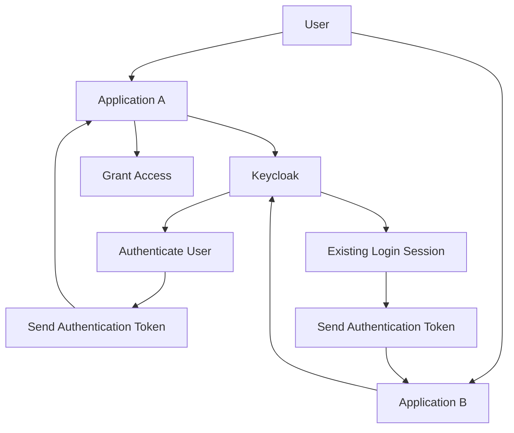

# **What is Keycloak?**

**Keycloak** is an open-source Identity and Access Management (IAM) solution.

It helps applications manage:

- User authentication (login).
    
- User authorization (access permissions).
    
- Single Sign-On (SSO).
    
- Identity Federation.
    
- User accounts and roles.
    
- Multi-Factor Authentication (MFA).
    

In simple words, **Keycloak is a centralized system that handles user login and identity management for multiple applications.**

## **1. Why do we need Keycloak?**

Imagine a company has three applications:

- Application A: Internal Dashboard
    
- Application B: Project Management
    
- Application C: Employee Portal
    

Without Keycloak:

- Each application might implement its own login system.
    
- Each application might store and manage user credentials separately.
    
- Managing users across applications becomes complicated.
    

With Keycloak:

- Keycloak manages user accounts and authentication.
    
- All three applications connect to Keycloak.
    
- Users can log in once and access multiple applications using SSO.
    

## **2. How does Keycloak work?**

Keycloak acts as an **Identity Provider (IdP)**.

It sits between users and applications and handles authentication.

### **Step-by-step**

1. A user opens Application A.
    
2. Application A redirects the user to Keycloak.
    
3. Keycloak asks the user to log in.
    
4. Keycloak verifies the credentials.
    
5. Keycloak sends an authentication token to Application A.
    
6. Application A validates the token and grants access.
    
7. The user opens Application B.
    
8. Application B also redirects to Keycloak.
    
9. Since the user already has an active Keycloak session, they don't need to enter their credentials again.
    

This is how Keycloak provides SSO.

## **3. Important Keycloak concepts**

|Concept|Meaning|
|---|---|
|Realm|A space where users, applications, roles, and authentication settings are managed.|
|Client|An application or service registered in Keycloak.|
|User|A person with an account in Keycloak.|
|Role|Defines what permissions a user has.|
|Identity Provider|An external system that Keycloak trusts for authentication.|
|Client Scope|Defines information and claims included in tokens.|
|Access Token|A token used to access protected resources.|
|Refresh Token|A token used to obtain new access tokens.|

## **4. What protocols does Keycloak support?**

Keycloak supports several authentication and authorization protocols:

|Protocol|Purpose|
|---|---|
|OpenID Connect (OIDC)|Authentication and user identity verification.|
|OAuth 2.0|Authorization and delegated access.|
|SAML 2.0|Enterprise authentication and identity federation.|

These protocols allow Keycloak to communicate with different applications and external Identity Providers.

## **5. Keycloak and Federation**

Keycloak can also connect to external Identity Providers.

For example:

- Your company uses Keycloak.
    
- Another organization uses Microsoft Entra ID.
    
- Your Keycloak instance trusts Microsoft Entra ID.
    
- Users can authenticate through Microsoft Entra ID and access applications connected to Keycloak.
    

Keycloak can also integrate with existing user directories such as LDAP and Active Directory.

## **6. Keycloak vs. SSO vs. OAuth vs. OIDC**

These concepts have different purposes:

|Term|What it is|
|---|---|
|Keycloak|A software solution for Identity and Access Management.|
|SSO|An authentication experience that allows one login across multiple applications.|
|OAuth 2.0|An authorization framework.|
|OIDC|An authentication protocol built on OAuth 2.0.|
|Federation|Establishing trust between independent identity systems.|

## **7. Is Keycloak free?**

Yes. Keycloak is an open-source project.

- Free to use.
    
- Can be self-hosted.
    
- Supports Docker deployment.
    
- Supports integration with different applications.
    
- Provides an administration console for managing users, roles, clients, and authentication settings.
    

Official website: [https://www.keycloak.org/](https://www.keycloak.org/?utm_source=chatgpt.com)

**Key takeaway:** Keycloak is a centralized Identity and Access Management system. Instead of implementing authentication separately in every application, you can use Keycloak to manage authentication, SSO, and identity federation centrally.

---
[[Backend]]