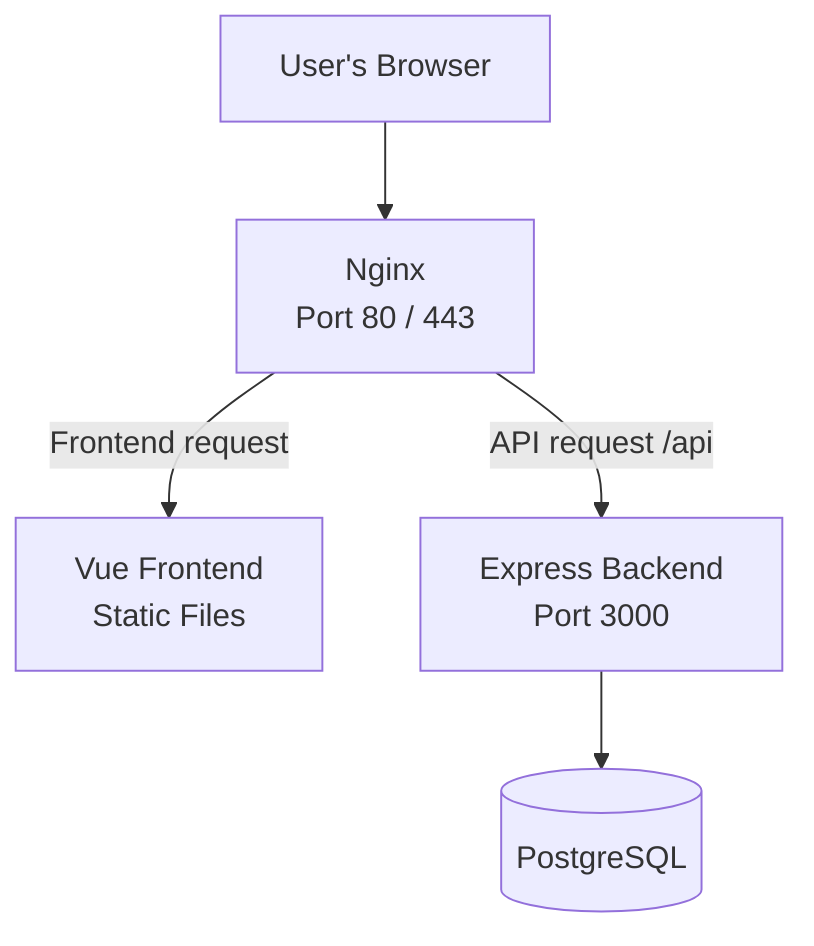
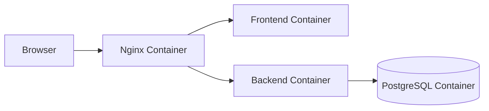

# What is Nginx?

Nginx (pronounced "Engine-X") is a web server that can also act as a reverse proxy, load balancer, and HTTPS termination point.

Think of it as a receptionist for your application: it receives incoming requests and decides where to send them.

## 1. What does Nginx do?

### Web server
Serves static files such as HTML, CSS, JavaScript, and images to users' browsers.

### Reverse proxy
Receives requests from users and forwards them to your backend application, such as an Express.js API.

### Load balancer
Distributes requests across multiple backend instances to help handle more traffic.

### HTTPS termination
Handles HTTPS connections and can forward requests to backend services over HTTP or HTTPS.

## 2. How does Nginx work with a backend?

Imagine you have a web application with a Vue frontend and an Express backend.

For example:

- `https://example.com/` → Nginx serves the frontend.
- `https://example.com/api/users` → Nginx forwards the request to Express on port `3000`.
- Express communicates with PostgreSQL when necessary.

The browser can use one public domain even though the frontend and backend are separate services.

## 3. Nginx vs. reverse proxy

Nginx is software; a reverse proxy is a role.

| Term | Meaning |
|---|---|
| Nginx | A specific software product |
| Reverse proxy | A function that forwards requests to backend servers |
| API gateway | A component that routes API requests and may add authentication, rate limits, and other API-specific policies |

Nginx can act as a reverse proxy. It can also handle some API gateway responsibilities, depending on its configuration and modules.

## 4. Nginx with Docker

For a typical Docker application, the architecture might look like this:

Nginx receives public traffic and routes it to the appropriate container over a Docker network.

The backend and database usually don't need to be exposed directly to the public internet.

## Key takeaway

Nginx often sits in front of an application, serving frontend files and forwarding API requests to the backend. It is especially useful when deploying applications to a server.

---
[[Backend]]
[[API-GW]]