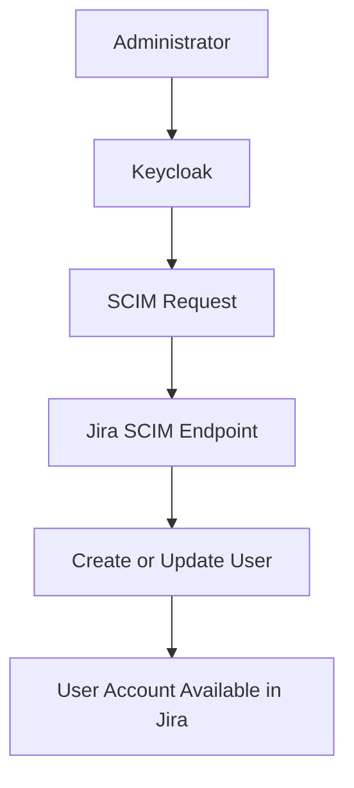

**SCIM (System for Cross-domain Identity Management)** is a standard protocol used to automatically manage user identities and groups across different applications and systems.

In simple words, **SCIM allows systems to automatically create, update, and delete user accounts in other systems.**

It is mainly used for user provisioning and deprovisioning.

## **1. Why do we need SCIM?**

Imagine a company has 100 employees who need access to:

- Slack
    
- Microsoft Teams
    
- Jira
    
- GitLab
    

Without SCIM:

- An administrator might need to manually create 100 accounts in each application.
    
- When an employee changes departments, their accounts must be updated manually.
    
- When an employee leaves the company, administrators must manually disable their accounts in every application.
    

With SCIM:

- User accounts can be created automatically.
    
- User information can be synchronized.
    
- Accounts can be disabled or deleted automatically.
    

## **2. How does SCIM work?**

SCIM usually works between two systems:

- **Identity Provider (IdP):** The system that manages user identities.
    
- **Service Provider (SP):** The application where user accounts need to be created or managed.
    

For example, imagine Keycloak manages your company's users and Jira is one of its applications.

### **Step-by-step**

1. An administrator creates a new employee account in Keycloak.
    
2. Keycloak sends a SCIM request to Jira.
    
3. Jira receives the request.
    
4. Jira automatically creates the employee's account.
    
5. If the employee's information changes, Keycloak sends an update request.
    
6. If the employee leaves the company, Keycloak can send a request to deactivate their account.
    

## **3. What operations does SCIM support?**

SCIM provides standard operations for managing identities.

|Operation|Meaning|Example|
|---|---|---|
|Create|Create a user account|Add a new employee|
|Read|Retrieve user information|Get employee details|
|Update|Modify user information|Change email or department|
|Delete|Remove a user|Delete an employee account|
|Group Management|Manage user groups|Add an employee to the Developers group|

SCIM uses REST APIs and JSON to exchange identity information.

## **4. Important SCIM concepts**

|Term|Meaning|
|---|---|
|Provisioning|Creating and managing user accounts|
|Deprovisioning|Removing or disabling user access|
|SCIM Client|System that sends SCIM requests|
|SCIM Server|System that receives and processes SCIM requests|
|User Resource|Information about a user|
|Group Resource|Information about a group of users|

## **5. SCIM vs. SSO**

These two concepts are related but solve different problems.

|SSO|SCIM|
|---|---|
|Handles user authentication across applications.|Handles user account provisioning across applications.|
|Allows users to log in once.|Automatically creates, updates, and deactivates accounts.|
|Answers: Who are you?|Answers: Which user accounts should exist in this application?|

### **Example**

Imagine a new employee joins your company.

**Without SCIM:**

1. An administrator manually creates their accounts in Slack, Jira, and GitLab.
    
2. The employee uses SSO to log in to these applications.
    

**With SCIM + SSO:**

1. The administrator creates the employee in the central identity system.
    
2. SCIM automatically provisions their accounts in Slack, Jira, and GitLab.
    
3. The employee uses SSO to access those applications.
    

## **6. SCIM and Keycloak**

Keycloak is an Identity and Access Management (IAM) solution.

It can manage user identities and provide authentication through OIDC and SAML.

SCIM, on the other hand, is a standard for exchanging user and group information between systems.

They can work together, but an important distinction is that **Keycloak does not provide a built-in general-purpose SCIM server in its standard distribution**. SCIM integration may require an extension or an external provisioning component.

**Key takeaway:**

- **Keycloak:** Manages identities and authentication.
    
- **SSO:** Allows one login across multiple applications.
    
- **OIDC / SAML:** Protocols for authentication and identity federation.
    
- **SCIM:** Automatically synchronizes user accounts and groups between systems.
    

Think of it this way:

- SSO lets you log in.
    
- SCIM makes sure your account already exists in the application before you try to log in.
  
  
---
[[Backend]]