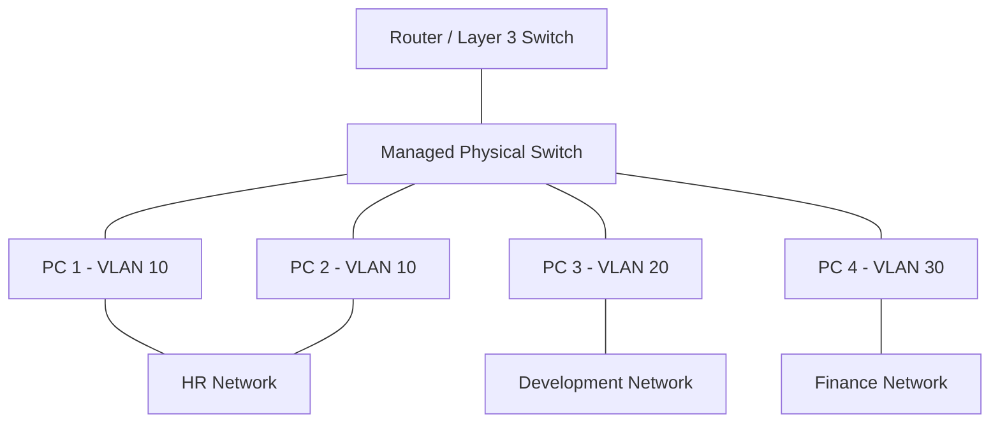

A VLAN (Virtual Local Area Network) is a way to divide one physical network into multiple separate logical networks.

Imagine an office with 50 computers. Instead of putting all 50 computers on the same network, you can use VLANs to separate them into groups, even if they're connected to the same physical switches.

## 1. Imagine an office

[linkedin.com](https://www.linkedin.com/posts/anas-asharaf_professional-network-diagram-of-a-companys-activity-7365184786337853440-ztCL?utm_source=chatgpt.com)

Suppose your company has three departments:

- HR: 10 computers
    
- Development: 25 computers
    
- Finance: 15 computers
    

Without VLANs, all 50 computers might share the same local network.

With VLANs, you can separate them:

VLAN 10

HR

192.168.10.0/24

Can communicate within its own network.

VLAN 20

Development

192.168.20.0/24

Separated from HR and Finance.

VLAN 30

Finance

192.168.30.0/24

Separated from the other departments.

All three groups can use the same physical network infrastructure, but VLANs logically separate their network traffic.

## 2. How does it work?

Three important concepts help explain VLANs:

- Switch: Connects devices inside a local network.
    
- VLAN ID: A number that identifies a VLAN, such as 10, 20, or 30.
    
- Router or Layer 3 switch: Routes traffic between VLANs when that communication is permitted.
    

Here's a simple network diagram you can paste into Obsidian:

The switch identifies which VLAN each port belongs to and keeps traffic separated accordingly.

Important: Devices in different VLANs generally cannot communicate directly at Layer 2. To communicate across VLANs, they need routing, and firewall or access-control rules can determine whether that communication is allowed.

## 3. Why do we use VLANs?

|Benefit|Explanation|
|---|---|
|Security|Separate sensitive departments from other devices.|
|Less unnecessary traffic|Limit broadcast traffic to the relevant VLAN.|
|Organization|Group devices by department, purpose, or application.|
|Flexibility|Devices can belong to the same logical network without being physically connected to the same switch.|

VLANs improve network separation, but they are not a complete security solution by themselves.

## 4. Access port vs. trunk port

These are two common switch-port types you'll encounter when configuring VLANs.

Access port

Usually connects an end device, such as a PC, to one VLAN.

Example: A developer's PC connects to a port assigned to VLAN 20.

Trunk port

Carries traffic for multiple VLANs over one link, typically between switches or between a switch and a router.

VLAN tags, commonly using IEEE 802.1Q, identify the VLAN for each frame on the trunk.

## 5. Test your understanding

Question: Two computers are connected to the same physical switch. PC A belongs to VLAN 10, and PC B belongs to VLAN 20. Can they communicate directly through the switch at Layer 2?

Yes, because they use the same switch.

No, because they belong to different VLANs.

Only if they have the same IP address.

Correct!

Different VLANs are separate Layer 2 broadcast domains. Communication between them requires Layer 3 routing, with appropriate network configuration and permissions.

In one sentence: A VLAN lets you create multiple logically separate networks using the same physical network equipment.

---
[[Backend]]